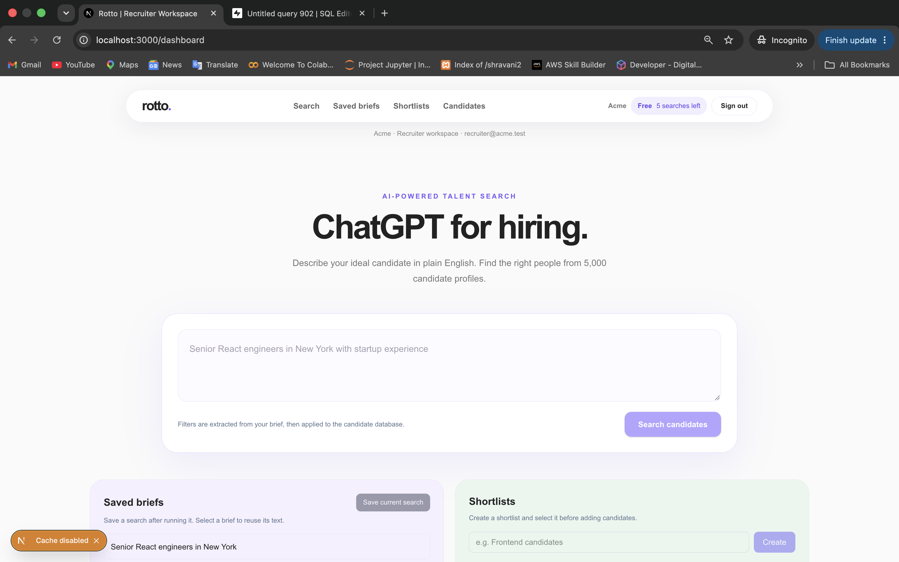
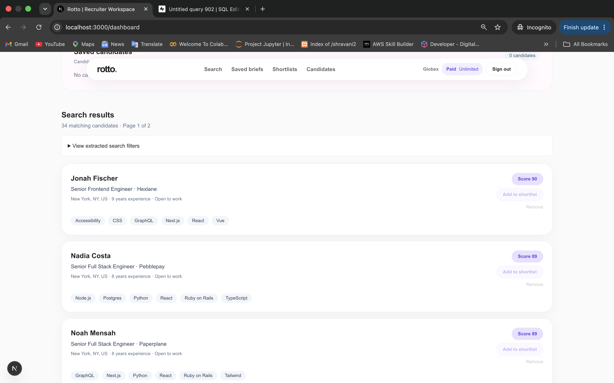
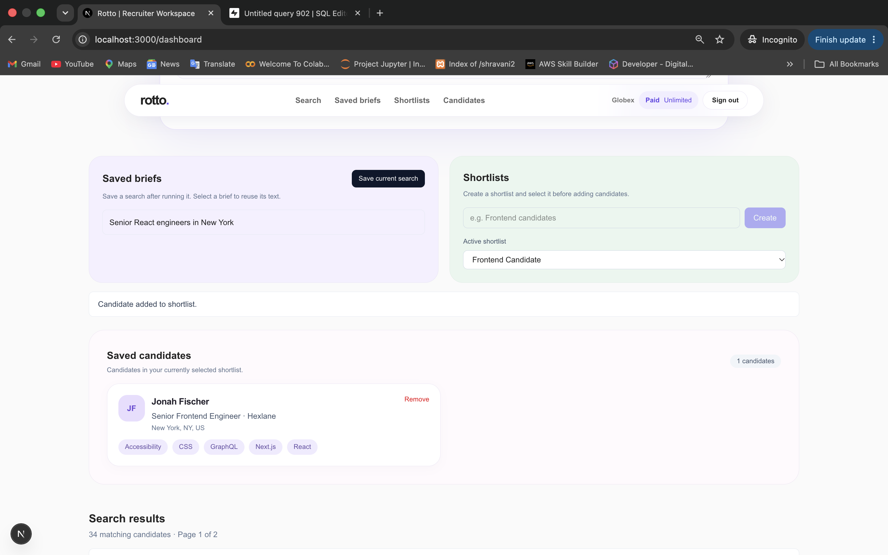
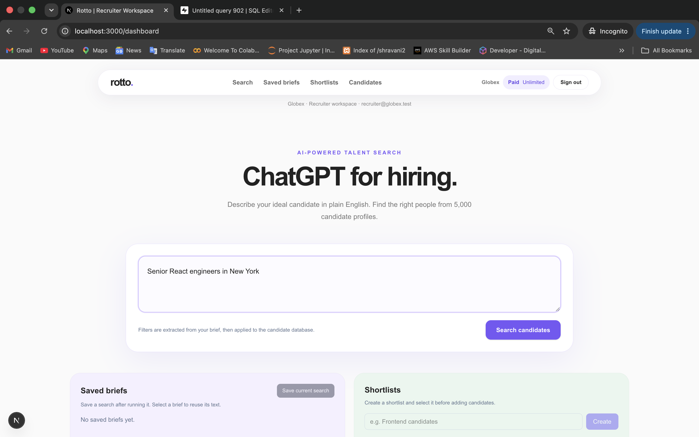
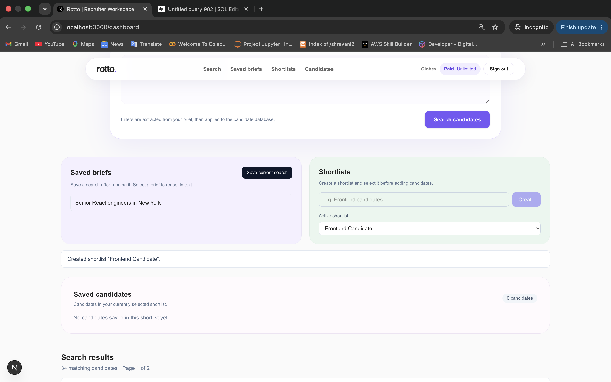
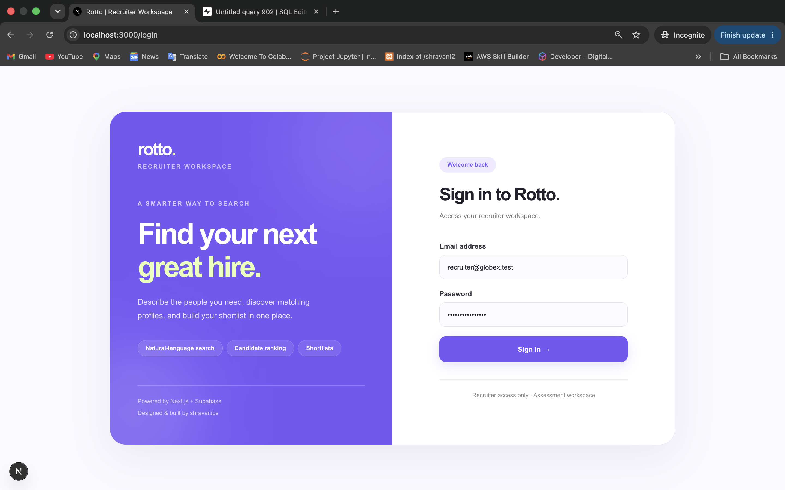

# Rotto Talent Search

A full-stack recruiting workspace that turns natural-language hiring briefs into structured, ranked candidate searches.

Recruiters can search across 5,000 candidate profiles, inspect matching results, save hiring briefs, and organize candidates into shortlists. The application also supports company-specific workspaces, free-tier search limits, and subscription updates through Stripe webhooks.

**Tech stack:** Next.js 16 · TypeScript · Tailwind CSS · Supabase Auth · PostgreSQL · OpenAI · Stripe Webhooks

## Application Preview

### Recruiter Workspace



### Natural-Language Search and Ranked Results



### Candidate Shortlisting



<details>
<summary>More screenshots</summary>

#### Paid Recruiter Workspace



#### Shortlist Creation



#### Recruiter Authentication



</details>

## Getting Started

### Prerequisites

- Node.js 24
- Docker Desktop (running)
- Make

### Local Setup

From the project root:

```bash
make setup
make dev
```

Open **http://localhost:3000/login**.

`make setup` installs dependencies, starts local Supabase, applies database migrations, seeds the recruiter accounts, imports the 5,000 candidate records, and configures the local development environment.

### Demo Accounts

| Company | Email | Password | Plan |
| --- | --- | --- | --- |
| Acme | `recruiter@acme.test` | `rotto-assessment` | Free — 5 searches |
| Globex | `recruiter@globex.test` | `rotto-assessment` | Paid — unlimited |

The local setup supports deterministic parsing with `MOCK_LLM=true`, allowing the complete search workflow to run without paid OpenAI API access.

## Architecture and Search Design

The central design decision is to separate **interpreting a hiring brief** from **retrieving candidates**.

```text
Recruiter hiring brief
         |
         v
Natural-language parser
(gpt-4.1-mini / deterministic mock)
         |
         v
Structured filter validation
         |
         v
PostgreSQL candidate filtering and ranking
         |
         v
Atomic quota consumption + search snapshot
         |
         v
Paginated results (20 candidates per page)
         |
         v
Saved briefs and recruiter shortlists
```

### 1. Natural-Language Parsing

The application uses `gpt-4.1-mini` to translate a recruiter's description into structured search filters, including role, seniority, location, skills, experience, education, and company type.

A deterministic mock parser is available for local development and reproducible testing.

### 2. Schema Validation

Parsed filters are validated against the application's supported schema and vocabulary.

Unsupported requirements are rejected rather than silently dropped. This makes the system's limitations explicit and avoids presenting results as though every requested constraint was applied.

### 3. Database-Grounded Retrieval

Candidate matching and ranking happen in PostgreSQL using validated filters.

**Hallucination guard:** The LLM does not receive the candidate database, select candidate IDs, or generate candidate profiles. Every returned candidate comes from an existing database record.

This keeps search results grounded in source data and makes the retrieval logic independently testable.

### 4. Persistent Search Results

Each completed search creates a company-scoped snapshot of ranked candidates.

Results are returned in pages of 20. Pagination reads the stored snapshot rather than executing a new search or consuming another search credit.

## Engineering Decisions

| Area | Implementation | Rationale |
| --- | --- | --- |
| Authentication | Supabase Auth | Restricts recruiter workflows to authenticated users |
| Tenant isolation | Company-scoped database access | Keeps Acme and Globex data separate |
| Search parsing | LLM-generated structured filters | Supports natural-language input without LLM-generated candidates |
| Retrieval | PostgreSQL filtering and ranking | Provides grounded, reproducible search results |
| Quota enforcement | Atomic PostgreSQL search creation | Prevents concurrent requests from bypassing free-tier limits |
| Pagination | Persisted ranked snapshots | Preserves result ordering and avoids additional quota consumption |
| Recruiter workflow | Saved briefs and shortlists | Supports repeated searches and candidate organization |
| Billing | Signed Stripe webhook processing | Handles subscription state changes, duplicate events, and out-of-order delivery |

## API Overview

Authenticated recruiter endpoints use a Supabase bearer token.

| Method | Endpoint | Purpose |
| --- | --- | --- |
| `POST` | `/api/search` | Parse a hiring brief and create a ranked search |
| `GET` | `/api/search/[id]` | Retrieve a saved search page |
| `GET` | `/api/people/[id]` | Retrieve a candidate profile |
| `GET / POST` | `/api/saved-briefs` | List and save hiring briefs |
| `GET / POST` | `/api/shortlists` | List and create shortlists |
| `GET` | `/api/shortlists/[id]` | Retrieve a shortlist |
| `POST / DELETE` | `/api/shortlists/[id]/people/[personId]` | Add or remove a candidate |
| `GET` | `/api/plan` | Retrieve the current company's plan and quota |
| `POST` | `/api/billing/events` | Process signed Stripe webhook events |

## Validation

The implementation was tested locally across the main application and API workflows:

- **Build and type safety:** Production build and TypeScript validation.
- **Authentication:** Recruiter sign-in, sign-out, and unauthorized API requests.
- **Tenant isolation:** Separate Acme and Globex workspaces.
- **Search correctness:** Structured filters, database ranking, and candidate retrieval.
- **Pagination:** Stable results across pages of 20 without consuming additional searches.
- **Quota enforcement:** Five successful searches for the free plan, followed by HTTP `402`.
- **Paid access:** Unlimited search behavior for the paid recruiter account.
- **Recruiter workflows:** Saving briefs, creating shortlists, and adding or removing candidates.
- **Webhook handling:** Signed Stripe events, duplicate delivery, and stale subscription events.

### LLM Testing Limitation

The OpenAI integration is implemented with `gpt-4.1-mini`, but completed end-to-end validation used `MOCK_LLM=true`.

A live model request was attempted but returned an API quota error. Live-model parsing behavior therefore remains unverified.

The mock parser is intended for reproducible local evaluation, not as a substitute for validating model quality in production.

## Tradeoffs and Future Work

The current retrieval system uses a constrained set of structured filters instead of unrestricted semantic search.

I chose this approach to prioritize predictable matching, auditable ranking, and clear separation between language interpretation and candidate retrieval. The tradeoff is that some natural-language requirements cannot yet be represented.

With another week, I would focus on:

1. **Automated end-to-end tests:** Cover authentication, search, quota enforcement, and shortlist workflows in a browser.
2. **Parsing evaluation:** Measure filter extraction accuracy and unsupported-requirement detection across more varied hiring briefs.
3. **Search quality:** Expand the filter vocabulary and evaluate ranking relevance against labeled queries.
4. **Observability:** Add latency measurements, structured logs, and search failure diagnostics.

## Demo

**Loom walkthrough:** Coming soon.

The walkthrough demonstrates recruiter authentication, natural-language search, ranked results, shortlisting, and free-versus-paid plan behavior.
